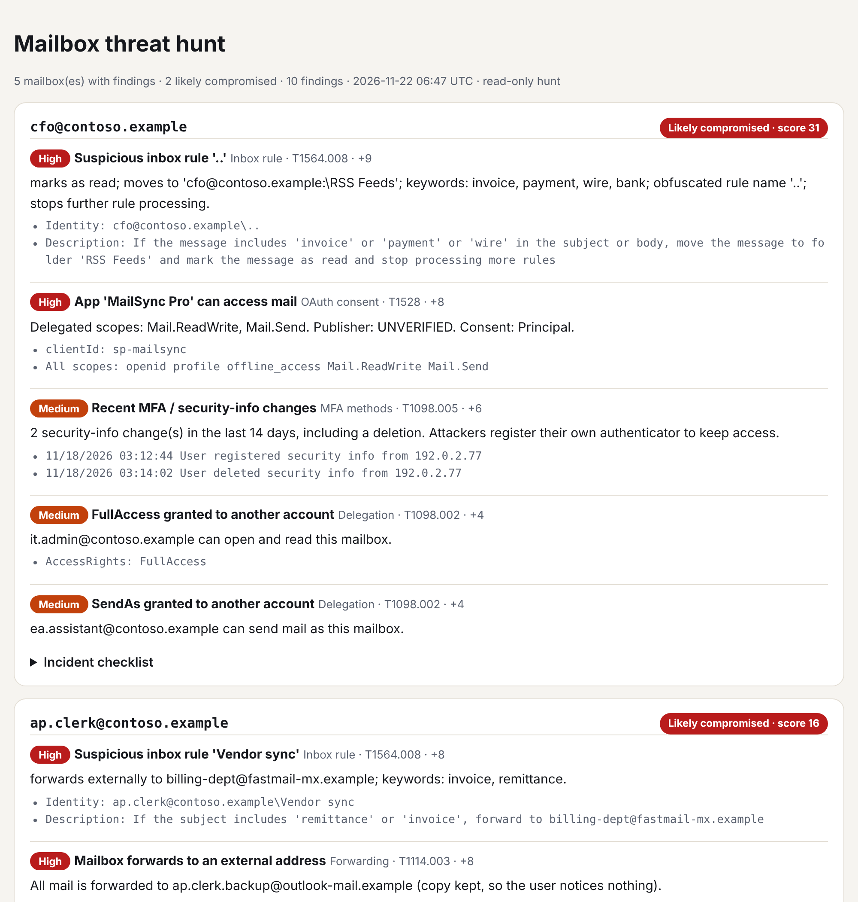

# MailboxThreatHunter

[](https://github.com/CadGoose/MailboxThreatHunter/actions/workflows/ci.yml)


**Business email compromise (BEC) triage for Exchange Online.** When a client calls with "our vendor says we sent them new bank details" or "the CFO's mailbox is acting weird", this answers the first questions in minutes:

- Is there an inbox rule hiding replies (moved to *RSS Feeds*, marked read, keyword *invoice*/*payment*)?
- Is mail being forwarded outside the company, by the mailbox or by a rule?
- Who else has FullAccess / SendAs?
- Did the user consent to an app that can read or send their mail?
- Were MFA methods registered or deleted recently?

Every finding is scored, each mailbox gets a verdict (**Likely compromised / Investigate / Review**), and the HTML report includes a containment checklist with the exact commands. Nothing is ever changed.



## Quick start

```powershell
git clone https://github.com/CadGoose/MailboxThreatHunter
Import-Module ./MailboxThreatHunter/MailboxThreatHunter/MailboxThreatHunter.psd1

# Try it on the bundled sample tenant (2 compromised mailboxes, 3 benign look-alikes)
Invoke-MailboxThreatHunt -InputPath ./MailboxThreatHunter/samples/contoso -OutputPath ./hunt.html

# Live tenant
Connect-ExchangeOnline                                        # View-Only Recipients + View-Only Configuration is enough
Connect-MgGraph -Scopes Directory.Read.All, AuditLog.Read.All # optional: OAuth consents + MFA changes
Invoke-MailboxThreatHunt -OutputPath ./hunt.html -CsvPath ./hunt.csv

# One reported user, fast
Invoke-MailboxThreatHunt -UserPrincipalName cfo@contoso.com -OutputPath ./cfo.html
Get-MTHIncidentChecklist -UserPrincipalName cfo@contoso.com
```

```
cfo@contoso.example          Likely compromised   score 31
ap.clerk@contoso.example     Likely compromised   score 16
hr.manager@contoso.example   Review               score 5
```

## What it looks for

| Signal | Scoring highlights | ATT&CK |
|---|---|---|
| **Inbox rules** | delete (+3), move to RSS Feeds / Archive / Conversation History (+3), external forward or redirect (+6), BEC keywords such as invoice, payment, wire, bank, hacked, phish (+2, whole-word), mark-as-read (+1), obfuscated names like `.` or `..` (+2), stop processing (+1); disabled rules discounted | T1564.008 |
| **Mailbox forwarding** | `ForwardingSmtpAddress` to a non-accepted domain (+8), noting whether a copy is kept so the user doesn't notice; internal `ForwardingAddress` (+2) | T1114.003 |
| **Delegation** | explicit FullAccess and SendAs, skipping SELF, inherited and built-in admin groups (+4) | T1098.002 |
| **OAuth consent** | delegated mail scopes (Mail.Read / ReadWrite / Send, EWS, IMAP, SMTP); **unverified publisher +3**, write/send +1 | T1528 |
| **MFA methods** | security-info registrations / deletions in the lookback window (default 14 days) | T1098.005 |

Verdicts per mailbox: **12+ Likely compromised**, **6–11 Investigate**, otherwise Review. Tenant-wide app consents appear under `(all users)` and stay in scope when you triage one user, because they can read that mailbox too.

## Evidence and offline analysis

```powershell
Export-MailboxThreatData -Path ./cases/2026-11-cfo -UserPrincipalName cfo@contoso.com
Invoke-MailboxThreatHunt -InputPath ./cases/2026-11-cfo -AcceptedDomain contoso.com
```

The JSON case folder can be attached to the ticket, shared with an IR firm, or re-analysed later. In offline mode the MFA lookback is measured from the newest event in the case, not today, so old cases still evaluate correctly.

## Permissions & safety

- **Exchange Online:** only `Get-*` cmdlets (`Get-EXOMailbox`, `Get-InboxRule`, `Get-EXOMailboxPermission`, `Get-EXORecipientPermission`, `Get-AcceptedDomain`).
- **Microsoft Graph:** only GET requests (`oauth2PermissionGrants`, `servicePrincipals`, `users`, `auditLogs/directoryAudits`). The test suite asserts no other HTTP methods are used.
- `Get-MTHIncidentChecklist` **prints** remediation commands. It never runs them.
- Rule names and descriptions are attacker-controlled text, so all report output is HTML-encoded.

## Development

```powershell
Invoke-Pester ./tests
Invoke-ScriptAnalyzer ./MailboxThreatHunter -Recurse -Settings ./PSScriptAnalyzerSettings.psd1
```

CI runs on Ubuntu and Windows. The tests include benign look-alikes (newsletter rules, internal team forwards, "achievement" not matching "ach") to keep false positives down.

## Related

- [kql-detection-library](https://github.com/CadGoose/kql-detection-library): real-time detections for the same behaviours (KDL-0015 inbox rules, KDL-0016 forwarding, KDL-0011 OAuth consent, KDL-0010 MFA registration)
- [entra-signin-analyzer](https://github.com/CadGoose/entra-signin-analyzer): find how the attacker got in from the sign-in logs

---

Built by **George Mkahail** ([@CadGoose](https://github.com/CadGoose)) · [cadgoose.github.io](https://cadgoose.github.io) · MIT License
